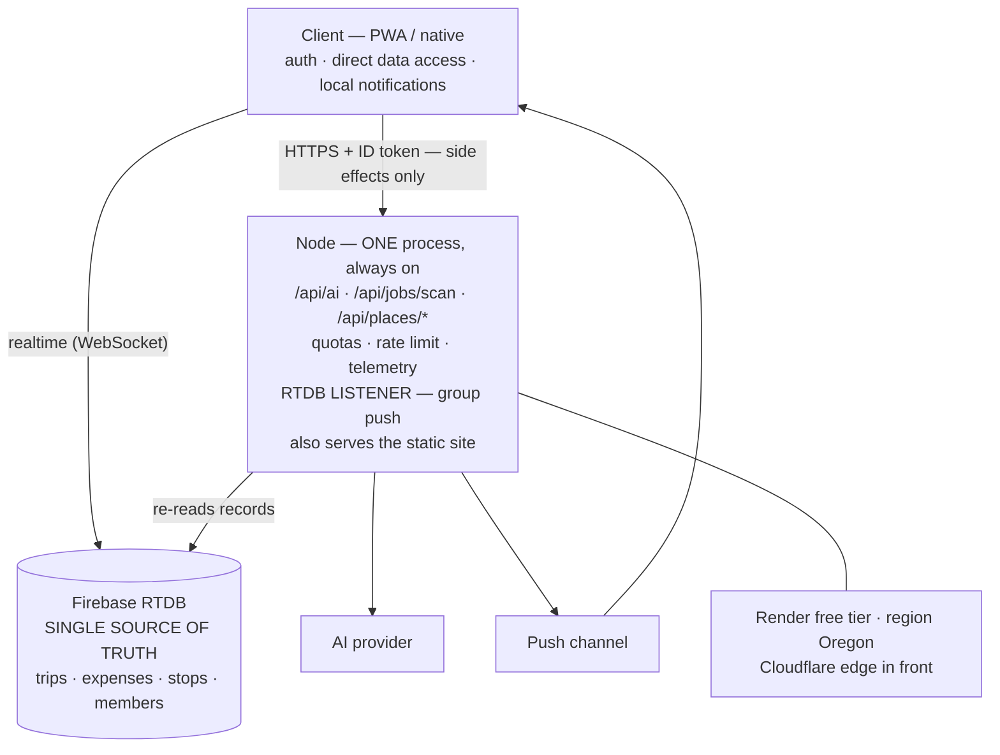
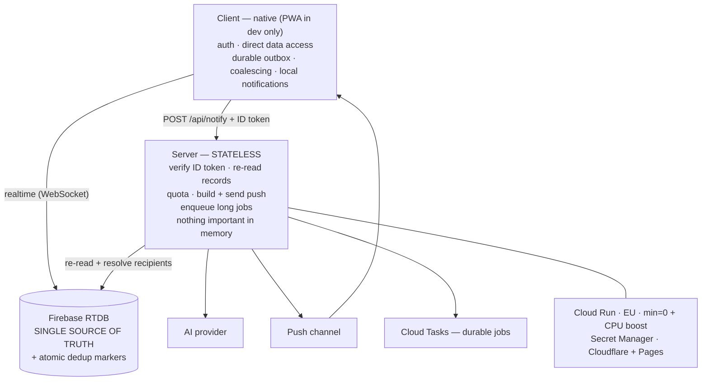

# System overview — phase 1 → phase 2

One change defines the whole story: **the state leaves the server.**

## Phase 1 — one process, always on, state in memory

The listener holds **six pieces of state in memory** and needs the process to
stay alive — so scale-to-zero is impossible by construction, and the service
sleeps on the free tier anyway. See [03](../docs/03-architecture-phase-1.md).

## Phase 2 — stateless, client-driven, scales to zero

The trigger moved to the client that performed the write, and the intent rides
the **outbox that already existed** — so durability, retry and replay came for
free. See [04](../docs/04-architecture-phase-2.md).

## What actually changed

| | Phase 1 | Phase 2 |
|---|---|---|
| Detects the change | a server process watching the database | the client that performed the write |
| Deduplication | in-memory cache | atomic transaction on the database |
| Coalescing | in-memory batch window | in the client, before sending |
| Scheduling | a timer in a live process | a durable on-disk outbox |
| Scaling | one instance, always on | many instances, scale to zero |
| Hosting bill at idle | free tier with a sleeping process | **€0** |

The dividing rule never changed: **data goes direct from the client** (authorised
by versioned rules), **side effects go through the server** (push, model calls,
quotas, privileges).
