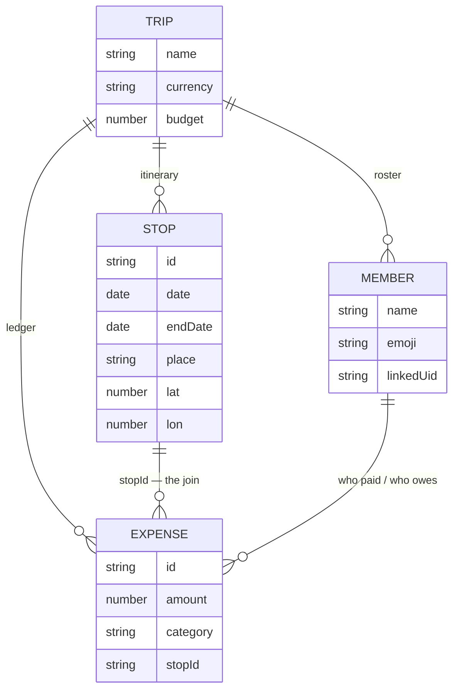
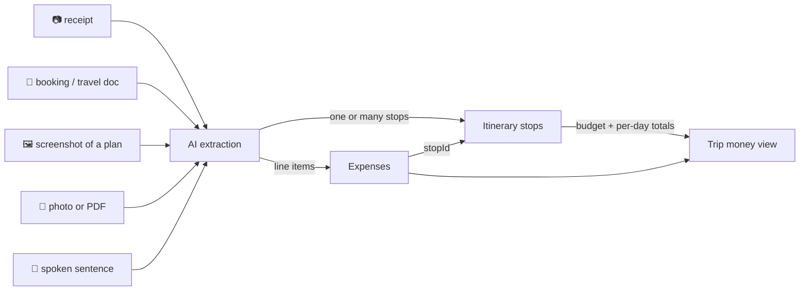

# The bridge: itinerary and money are one object

The product thesis in [01](../docs/01-what-kompa-is.md) is that what a group
plans and what it spends are the same object. This is the data relationship that
makes it true — and it is why an itinerary stop can show what it cost.

*(The shape, not the full schema: the fields shown are the ones that carry the
join.)*

## Why the join is a relationship and not a screen

| If the join were a screen… | Because it is a relationship… |
|---|---|
| the plan and the money could disagree | a stop shows the cost of its own expenses |
| a budget could not be attributed to anything | a trip carries a budget, readable per day |
| two features, two mental models | one object: *what we planned, and what it cost* |

Two small modules do the work: `stopExpense` decides what a stop has cost so
far, and `stopReminders` / `reminderPlan` derive reminders from the stops that
carry a time.

## One capture surface, feeding both halves

The model proposes, the user confirms — and money is never computed by the
model: splitting, settlement and balances are pure functions, identical on both
clients and covered by tests. See [02](../docs/02-ai-as-the-product.md).
