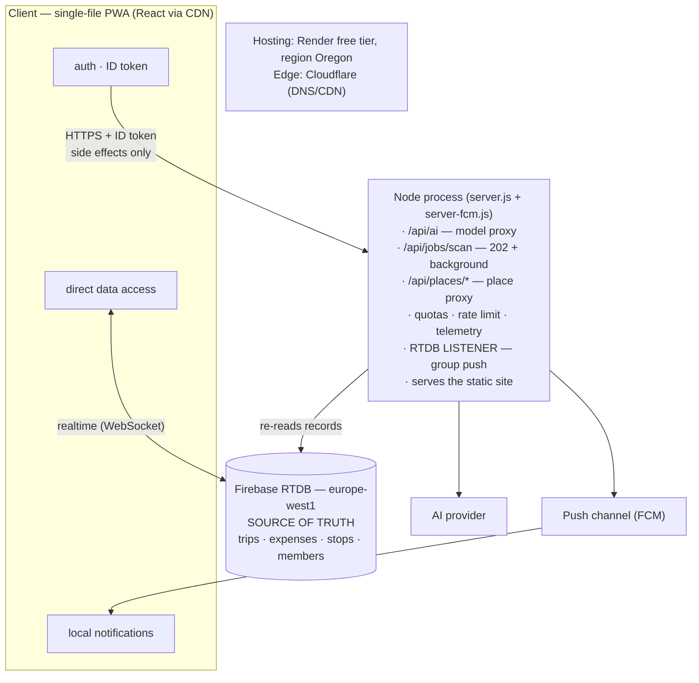

# 03 — Architecture, phase 1: one process on Render

## The shape

Phase 1 is the architecture that carried the product from a single HTML file to
a live app with real groups: a **web client**, a **Node process**, and a
**realtime database** as the single source of truth.

The whole backend is **one process**, and it does four unrelated jobs at once:
it proxies the model, it runs extraction jobs, it watches the database to send
group notifications, and it serves the static site. That is not a mistake — it
is what a small team can operate at this stage, and it is the reason the first
version shipped at all.

## The dividing rule

The one rule that decides where code lives, and the rule that survived every
later change:

> **Data → the client talks to the database directly**, authorised by versioned
> security rules.
> **Side effects → the server only**: push, model calls, quotas, privileges.

It is why realtime sync is free (the client subscribes to the data it displays)
and why the rules file is a security boundary rather than a formality — see
[06](06-security.md).

## Why the server cannot be removed

Not a preference: three things are structurally impossible in the client.

| Reason | Detail |
|---|---|
| **The push credential** | whoever holds it can send a notification to **every user of the app**, in the app's name. A downloadable binary cannot hold it. |
| **The model key** | same argument, smaller blast radius ([02](02-ai-as-the-product.md)). |
| **"Who are you / are you a member / does this exist"** | must be answered by something the client cannot forge. |

So the question was never *whether* a server exists, but **what it is allowed to
remember**.

## How group notifications worked in this phase

A process held **persistent subscriptions** on `group_history`,
`group_itinerary` and `group_people`, and pushed when something changed. The
subscriber is never the writer, so the process had to *infer* what had happened —
and to infer it, it kept six pieces of state in memory:

| State | What it was for |
|---|---|
| Boot timestamp + grace window | ignore pre-existing data on startup |
| A "last seen" map | detect what actually changed |
| A "linked" map | distinguish "person added" from "person joined" |
| A pending batch + window | coalesce a burst into one push |
| A dedup cache | avoid duplicate pushes |
| A timer per group | schedule the flush |

Every one of those was correct. Together they were **the phase's real cost**,
and they are the subject of [04](04-architecture-phase-2.md).

## What this phase bought

| Bought | Why it mattered |
|---|---|
| **Realtime sync for free** | the client subscribes to the database; no polling, no socket server to write |
| **One deploy, one process** | no containers, no orchestrator, no CI beyond a build |
| **Low cost at low volume** | free tier hosting, free tier model, a database that is generous before it is expensive |
| **A working product to validate** | the thing the roadmap actually needed |

## What it cost: three structural debts

| Debt | Consequence |
|---|---|
| **The process must always run** | a host that scales to zero is impossible by construction — and scale-to-zero is what makes the hosting bill in [07](07-cost.md) round to zero |
| **Six pieces of in-memory state** | horizontal scaling is impossible: with two instances each holds its own half-truth and the dedup cache stops deduplicating |
| **The free tier suspends idle services** | the service sleeps after 15 minutes without **inbound** traffic. The listener's connection is **outbound**, so it did not prevent the sleep — and group pushes silently stopped until the next request woke the process |

That third row is the interesting one, because it is not a bug in the code. The
code was doing exactly what it was written to do, on a host whose terms were not
read carefully enough. **It is a mismatch between an architecture and a
platform's lifecycle**, and it cannot be fixed by patching the code.

## The conclusion

The AI latency problem that started this investigation ([05](05-problems-and-fixes.md))
was fixed in one line. But the fix made the *next* question unavoidable: if the
product is going to live on a host that scales to zero, then **nothing that
matters can live in memory** — and the notification system, the most valuable
part of the product, was made of memory.

That is phase 2.

→ Next: [04 — Architecture, phase 2](04-architecture-phase-2.md)
