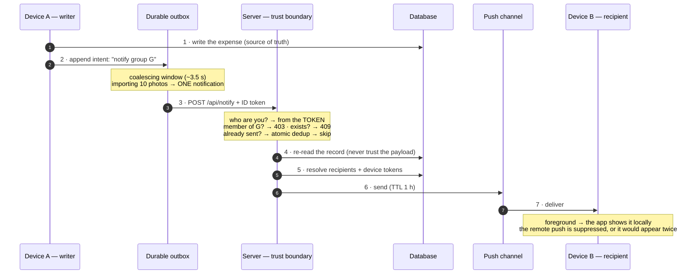

# 04 — Architecture, phase 2: stateless, client-driven push, Cloud Run

## The constraint that forced the change

Phase 1 had three debts ([03](03-architecture-phase-1.md)), and the first one is
the one that matters: **the process had to be always running**, so the product
could not move to a host that scales to zero — which is exactly the host whose
bill rounds to zero in [07](07-cost.md).

So the goal was not "make the server stateless" as an exercise. It was: **make
scale-to-zero possible**, and accept whatever that costs in design.

## The move: from observed to reported

| | Phase 1 | Phase 2 |
|---|---|---|
| Who detects the change | a server process **watching** the database | the **client that performed the write** |
| Deduplication | an in-memory cache | an **atomic transaction on the database** |
| Coalescing | an in-memory batch window | **in the client**, before it sends |
| Scheduling | a timer inside a live process | a **durable on-disk outbox** with retries |

The argument for the client is not convenience, it is **information**: the
client already knows everything the server had to infer — whether this was a
user action or an automatic fill, an add or an edit, whether it is mid-way
through importing ten photos.

And the intent travels on the **write outbox that already existed** (the journal
that makes offline writes durable). Retry, replay and persistence were already
solved; the notification merely became another passenger.

## The flow

The server kept exactly one job: **the trust boundary**. It decides *who you
are*, *whether you belong*, *whether the thing exists* and *whether it was
already sent* — and it builds the message text itself, from the record, with a
pure template ([06](06-security.md)).

## The blocking condition nobody sees coming

Moving the trigger into the client means the client becomes **part of the
contract**: every writer must report. And there was a second writer — the legacy
PWA, still installed on devices, still writing to the same collections through a
different code path. Its writes would have been silently unannounced.

The fix is one of the more satisfying pieces of the project: the PWA was
**disabled in production** behind a single variable, and its service worker was
turned into a **kill-switch** that uninstalls it from devices that still have it.

| `SERVE_PWA` | Behaviour |
|---|---|
| unset | PWA in development, static landing in production (default, from `NODE_ENV`) |
| `1` | the PWA |
| `0` | the static landing |

In production `/`, `/join/...` and `/w/...` now serve the landing, while
`/sw.js` removes the old client. Deep links keep working.

**The lesson is bigger than the fix:** "the app" is not one program, and the
moment a responsibility moves into a client, *every* client version in the wild
joins the contract.

## The target host: Cloud Run, measured before chosen

The hosting decision was made with numbers, not preferences — including the one
number that usually kills scale-to-zero, measured on Node 20, 1 vCPU / 512 MB,
`europe-west1`:

| Configuration | Cold p99 | Warm p50 | Idle cost |
|---|---|---|---|
| `min=0` | **1 600–1 800 ms** | 45 ms | **€0** |
| `min=0` + Startup CPU Boost | **900–1 100 ms** | 45 ms | ~€0 |
| `min=1` | 70–120 ms | 45 ms | **~$59/month** |

A cold start only hits the first request after an idle period — and in this
product that request is the **submission of an asynchronous extraction job**,
whose result the user is not waiting on. So the cold start is invisible, and
paying ~$59/month to hide it would be paying to solve a problem the product does
not have.

**Durable jobs (Cloud Tasks)** complete the picture: they turn fire-and-forget
work into a tracked, retryable, observable request — which is both correct and
what makes `min=0` safe. It is the last item still to ship.

## What is still stateful

Honest inventory of what remains in memory on the server:

| State | Status |
|---|---|
| Per-user daily quota | ✅ persisted, atomic transaction on the database |
| **Per-user rate limit** | ⚠️ **still an in-memory map** |

The rate limit is the last piece of instance-local state. It is bounded (the
worst case is the limit multiplied by the number of instances), but it is
inconsistent with the rest of the design, and it is on the list before the
migration ships.

→ Next: [05 — Problems and fixes](05-problems-and-fixes.md)
